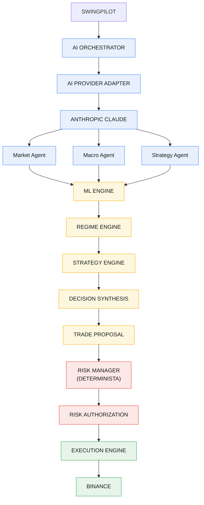

# Documento de Integración de Inteligencia Artificial (SwingPilot)

---

## ¿Para qué existe este documento?

Este apartado define cómo se integrará la inteligencia artificial dentro de SwingPilot: arquitectura, responsabilidades, comunicación, contratos de datos, límites de autoridad y requisitos operativos.

El objetivo no es construir un chatbot que recomiende operaciones, sino un sistema de inteligencia coordinada capaz de analizar información de mercado y contexto macroeconómico; interpretar condiciones técnicas y estructurales; evaluar estrategias cuantitativas; incorporar modelos de Machine Learning (ML, aprendizaje automático); generar propuestas de operación sustentadas en evidencia; consolidar resultados de distintos agentes; entregar propuestas al sistema determinista de gestión de riesgo; y mantener trazabilidad completa desde el análisis hasta el resultado de una operación.

La IA debe mejorar la capacidad de análisis y toma de decisiones del sistema, sin adquirir autoridad sobre el capital, los límites de riesgo ni la ejecución.

---

## ¿En qué contexto opera SwingPilot?

SwingPilot es un sistema orientado a Swing Trading (operaciones de varios días a semanas) de criptomonedas, con Binance como exchange de referencia.

### ¿Qué instrumentos y temporalidades usa?

| Elemento | Configuración de referencia |
|---|---|
| Activo prioritario | BTC/USDT |
| Activo secundario | Ninguno — solo BTC/USDT autorizado |
| Estilo operativo | Swing Trading |
| Temporalidades | H1, H4 y 1D |
| Contexto de mercado | 1D |
| Estructura y señal | H4 |
| Evaluación de entrada | H1 |

Las temporalidades son complementarias, no reglas rígidas. Por lo tanto, la duración de una operación dependerá de la estrategia, la invalidación, las condiciones de mercado y las reglas de salida.

### ¿Qué límites operativos de referencia aplican?

- Máximo de referencia: 8 operaciones ejecutadas por mes.
- No existe obligación de operar ni de alcanzar una cantidad mínima de operaciones.
- Riesgo máximo por operación: 1.5% del capital (límite vinculante), sujeto a las restricciones agregadas.
- Tickets habituales de referencia: $500–$5,000 MXN.
- Ticket extraordinario de referencia: hasta $10,000 MXN.
- El riesgo agregado y las posiciones simultáneas deben evaluarse conjuntamente.

Estas cifras son parámetros de referencia del sistema. Su configuración, modificación y aprobación corresponden al operador.

### ¿Quién decide sobre el capital?

**SwingPilot no decide cuánto capital debe aportar, retirar, reservar o comprometer el operador.**

La IA no puede incrementar el capital disponible, recomendar una aportación como si fuera una autorización, transferir fondos, modificar el presupuesto operativo, aumentar automáticamente el tamaño de una posición ni interpretar una oportunidad de mercado como autorización para utilizar más capital.

El operador conserva la autoridad sobre el capital y su distribución. El sistema puede presentar escenarios, exposición, necesidades de liquidez y consecuencias de riesgo, pero no tomar la decisión financiera en su nombre. Las tablas de autoridad y las decisiones no delegadas amplían este límite en las secciones correspondientes.

---

## ¿Qué principios arquitectónicos están aprobados?

Los siguientes principios (D1–D4) rigen diseño, contratos, eventos y proveedor LLM (Large Language Model, modelo de lenguaje de gran escala).

### D1. Orquestador central y agentes especializados

>[!failure] SE APRUEBA 
<badge color="success">Aprobado</badge>

SwingPilot utilizará un **AI Orchestrator central** que coordinará agentes especializados bajo demanda. No se permitirá una red de agentes autónomos comunicándose libremente y tomando decisiones sin coordinación.

Responsabilidades del Orchestrator:

- Recibir solicitudes de análisis.
- Determinar qué agentes deben participar.
- Preparar y distribuir el contexto necesario.
- Administrar identificadores de correlación.
- Coordinar análisis paralelos y secuenciales.
- Validar que las respuestas cumplan sus contratos.
- Enviar los resultados a Decision Synthesis.

También deberá registrar las interacciones y resultados, y gestionar errores, tiempos de espera y respuestas incompletas.

El Orchestrator coordina el proceso, pero no inventa señales ni sustituye a los motores deterministas.

### D2. Contratos estructurados, versionados y auditables

<badge color="success">Aprobado</badge>

Toda comunicación entre componentes inteligentes deberá utilizar contratos de entrada y salida estructurados. Formato de referencia: JSON validado mediante esquemas versionados.

Requisitos:

- Cada agente tendrá un contrato de entrada explícito y un contrato de salida explícito.
- Los campos obligatorios deberán validarse.
- Las respuestas deberán incluir su versión de esquema.
- Los resultados deberán identificar sus fuentes y referencias.
- Los datos faltantes deberán declararse, nunca inventarse.
- Las conclusiones deberán diferenciar hechos, inferencias y recomendaciones.

Además, los errores deberán representarse de forma estructurada, y los cambios incompatibles requerirán una nueva versión del contrato.

No se aceptará texto libre como único mecanismo de intercambio entre componentes críticos. Los agentes podrán generar explicaciones en lenguaje natural como información complementaria, pero los resultados operativos deberán estar disponibles en estructuras verificables. El protocolo de mensajes desarrolla estos requisitos en «¿Cómo se intercambian mensajes y eventos?».

### D3. Comunicación orientada a eventos

<badge color="success">Aprobado</badge>

La comunicación entre los componentes de SwingPilot seguirá un modelo orientado a eventos. Los eventos representarán hechos, solicitudes, resultados, decisiones y cambios de estado; el sistema deberá poder reconstruir el ciclo completo de una operación mediante sus eventos relacionados.

Requisitos:

- Identificadores únicos de mensajes.
- Correlación entre eventos de un mismo análisis u operación.
- Registro de causalidad entre eventos.
- Timestamps UTC.
- Identificación de la fuente y el destinatario.
- Versionado de esquemas.
- Validación del contenido.

Y también: idempotencia en operaciones sensibles, registro de estados y errores, y conservación de la secuencia de eventos.

### D4. Proveedor principal de inteligencia artificial

<badge color="success">Aprobado</badge>

Anthropic Claude será el proveedor LLM principal de SwingPilot.

| Componente | Responsabilidad |
|---|---|
| Claude Pro | Desarrollo, investigación y asistencia mediante Claude Code |
| Anthropic API | Inferencia LLM de los agentes en el runtime de SwingPilot |
| Python y librerías ML | Cálculo, clasificación, predicción y evaluación cuantitativa |
| Binance API | Datos de mercado y operaciones autorizadas |
| Telegram Bot API | Interfaz operativa y notificaciones |
| Infraestructura SwingPilot | Orquestación, persistencia, seguridad, auditoría y ejecución |

**Importante:** Claude Pro no constituye una licencia de uso programático de la API. El runtime de producción deberá utilizar Anthropic API mediante una cuenta de Anthropic Console y facturación independiente.

Claude Code puede trabajar sobre el repositorio local, pero la inferencia de Claude ocurre en la infraestructura de Anthropic. Esto no equivale a ejecutar el modelo localmente.

El sistema deberá utilizar un adaptador de proveedor de IA para evitar acoplar el Orchestrator directamente a la implementación de Anthropic. No se requiere incorporar múltiples proveedores LLM en la primera versión.

---

## ¿Cómo se organizan agentes y motores?

Esta sección describe el flujo lógico, los agentes basados en LLM y los componentes con lógica determinista o cuantitativa.

### Vista general del flujo



Esta vista representa el flujo lógico. No obliga a desplegar cada componente como un servicio independiente.

### Market Analyst

Responsabilidad: interpretar las condiciones actuales del mercado.

Funciones: analizar estructura de precios; identificar tendencias y cambios estructurales; interpretar indicadores técnicos; detectar zonas relevantes de soporte y resistencia; identificar volatilidad y condiciones de liquidez; evaluar coherencia entre temporalidades; identificar posibles rupturas y falsas rupturas.

Entrada: datos de mercado, indicadores, temporalidades y contexto disponible.

Salida: análisis estructurado con observaciones, evidencia, confianza, limitaciones y timestamp de los datos utilizados.

No puede autorizar operaciones.

### Macro Analyst

Responsabilidad: evaluar el contexto macroeconómico y los acontecimientos externos relevantes para los activos analizados.

Funciones: analizar noticias económicas y financieras; identificar eventos macroeconómicos relevantes; evaluar acontecimientos regulatorios; analizar acontecimientos institucionales; identificar posibles catalizadores de volatilidad; distinguir acontecimientos confirmados de rumores o especulación.

Entrada: fuentes de noticias, información macroeconómica y datos temporales.

Salida: eventos relevantes, impacto potencial, horizonte temporal, fuentes, fecha de publicación y nivel de incertidumbre.

No puede convertir una noticia en una señal de entrada por sí sola.

### Strategy Analyst

Responsabilidad: analizar y explicar las estrategias candidatas.

Funciones: evaluar la lógica de una estrategia; analizar sus condiciones de activación; revisar coherencia entre señal e invalidación; identificar condiciones que debiliten una oportunidad; comparar estrategias cuando exista evidencia suficiente; explicar las razones para descartar una oportunidad.

Debe trabajar sobre estrategias formalmente definidas por Strategy Engine o Research. No puede modificar silenciosamente parámetros de estrategias aprobadas ni ejecutar operaciones.

### Risk Analyst

Responsabilidad: realizar una evaluación informativa complementaria de los riesgos identificados.

Funciones: detectar riesgos no evidentes; señalar inconsistencias entre entrada, stop-loss y objetivo; identificar exposición a acontecimientos externos; evaluar riesgos operativos y de datos; cuestionar supuestos de la propuesta.

Su evaluación es consultiva. **Risk Analyst no sustituye al Risk Manager determinista y no tiene autoridad para aprobar operaciones.**

### Decision Synthesis

Responsabilidad: consolidar los resultados de los agentes.

Funciones: integrar los análisis disponibles; identificar coincidencias y contradicciones; preservar desacuerdos relevantes; identificar datos faltantes; evaluar la consistencia de la evidencia; presentar escenarios y argumentos a favor y en contra; generar una propuesta estructurada cuando exista información suficiente.

No debe fabricar consenso ni ocultar incertidumbre. Su salida será una propuesta de operación o una conclusión de no operación.

### Componentes no basados en LLM

Los siguientes componentes deben conservar lógica propia, verificable y reproducible:

| Componente | Función |
|---|---|
| Trading Engine | Gestión de datos y estado del mercado |
| Market Intelligence | Preparación y normalización de información |
| Regime Engine | Clasificación de régimen de mercado |
| Strategy Engine | Evaluación programática de estrategias |
| ML Engine | Modelos cuantitativos y aprendizaje automático |
| Portfolio Manager | Estado y exposición del portafolio |
| Risk Manager | Validación y autorización determinista |
| Execution Engine | Envío y reconciliación de órdenes |
| Fiscal Ledger | Registro de eventos y contabilidad fiscal |
| Research & Backtesting | Investigación y evaluación experimental |
| Audit & Governance | Trazabilidad, versiones y control |

La IA puede interpretar resultados de estos componentes, pero no sustituir sus cálculos críticos.

---

## ¿Cómo se intercambian mensajes y eventos?

### Contrato universal de mensajes

Todo evento o mensaje intercambiado deberá contener, como mínimo:

```json
{
  "message_id": "uuid",
  "correlation_id": "uuid",
  "causation_id": "uuid-or-null",
  "schema_version": "1.0",
  "source": "market_analyst",
  "destination": "decision_synthesis",
  "message_type": "MARKET_ANALYSIS_COMPLETED",
  "timestamp_utc": "2026-11-10T12:00:00Z",
  "data_timestamp_utc": "2026-11-10T11:59:00Z",
  "asset": "BTC/USDT",
  "timeframe": "H4",
  "payload": {},
  "status": "completed"
}
```

Los valores anteriores son ilustrativos. El `payload` tendrá un esquema específico según `message_type`.

### Requisitos de los contratos especializados

Cada contrato deberá documentar nombre e identificador, versión, propósito, productor autorizado, consumidores autorizados, campos obligatorios, campos opcionales, tipos de datos, enumeraciones permitidas, reglas de validación, manejo de errores, ejemplos válidos y compatibilidad con versiones anteriores.

No se permitirá que un agente agregue campos críticos no reconocidos y que estos sean interpretados como instrucciones ejecutables.

### Catálogo de eventos principales

El catálogo inicial deberá contemplar eventos equivalentes a:

| Evento | Propósito |
|---|---|
| `ANALYSIS_REQUESTED` | Iniciar un análisis |
| `MARKET_ANALYSIS_COMPLETED` | Registrar análisis de mercado |
| `MACRO_ANALYSIS_COMPLETED` | Registrar análisis macro |
| `ML_INFERENCE_COMPLETED` | Registrar inferencia ML |
| `REGIME_CLASSIFIED` | Registrar régimen de mercado |
| `STRATEGY_CANDIDATE` | Presentar estrategia candidata |
| `DECISION_SYNTHESIS_COMPLETED` | Consolidar análisis |
| `TRADE_PROPOSAL` | Presentar propuesta |
| `RISK_APPROVED` | Autorizar una propuesta |
| `RISK_REJECTED` | Rechazar una propuesta |
| `RISK_REQUIRES_REVIEW` | Solicitar revisión |
| `ORDER_SUBMITTED` | Registrar envío de orden |
| `ORDER_PARTIALLY_FILLED` | Registrar ejecución parcial |
| `ORDER_FILLED` | Registrar ejecución completa |
| `ORDER_CANCELLED` | Registrar cancelación |
| `ORDER_REJECTED` | Registrar rechazo del exchange |

Los nombres y esquemas definitivos deberán quedar registrados en el catálogo de eventos del sistema.

---

## ¿Cuál es el flujo integral de decisión?

El proceso desde datos hasta ejecución y retroalimentación sigue siete fases encadenadas.

### Fase 1. Captura y preparación de datos

Trading Engine y Market Intelligence obtienen y preparan los datos necesarios. Como resultado, deberán validar integridad y consistencia; identificar temporalidad y activo; registrar fuente y timestamp; detectar datos faltantes, duplicados u obsoletos; y mantener separación entre tiempo de mercado y tiempo de procesamiento.

Si los datos no cumplen las condiciones mínimas, el análisis no deberá producir una propuesta ejecutable.

### Fase 2. Análisis paralelo

El Orchestrator distribuye el contexto necesario a Market Analyst, Macro Analyst, ML Engine y Regime Engine. Los resultados se relacionan mediante un mismo `correlation_id`.

Cada componente deberá entregar su resultado o un estado explícito de error, indisponibilidad o insuficiencia de información.

### Fase 3. Evaluación de estrategias

Strategy Engine evalúa las estrategias disponibles, por ejemplo Trend Following, Momentum, Mean Reversion, Breakout, Volatility-Based y ML-Based. Estas familias son referencias de investigación, no estrategias automáticamente habilitadas para producción.

Una estrategia deberá tener una definición versionada, condiciones de entrada y salida, reglas de invalidación y evidencia experimental correspondiente. Las estrategias candidatas se representan mediante `STRATEGY_CANDIDATE`.

### Fase 4. Síntesis de decisión

Decision Synthesis recibe los análisis y resultados de estrategia y debe determinar si existe información suficiente para generar una propuesta, solicitar información adicional, descartar la oportunidad o indicar que existe desacuerdo entre fuentes.

Cuando exista una propuesta, deberá generar `TRADE_PROPOSAL`. La propuesta no es una orden ni una autorización.

### Fase 5. Validación determinista de riesgo

Risk Manager recibe la propuesta y ejecuta sus propias validaciones. Como mínimo deberá verificar:

- Capital disponible previamente configurado por el operador.
- Riesgo monetario y porcentual.
- Stop-loss y distancia de invalidación.
- Exposición agregada.
- Posiciones simultáneas.
- Límite mensual de operaciones ejecutadas.
- Instrumentos permitidos.

Y además: liquidez y condiciones de ejecución; integridad y vigencia de datos; versión de la estrategia; duplicidad de propuestas u órdenes; consistencia de cantidades y límites operativos.

Resultados posibles: `RISK_APPROVED`, `RISK_REJECTED`, `RISK_REQUIRES_REVIEW`. El sistema no podrá interpretar la ausencia de respuesta como aprobación.

### Fase 6. Autorización y ejecución

Una autorización deberá estar vinculada a propuesta original, identificador de autorización, instrumento, cantidad máxima autorizada, límites de precio o condiciones de ejecución, vigencia, versión de las reglas de riesgo y estado de autorización.

Execution Engine únicamente aceptará autorizaciones válidas. Si la autorización expira, se revoca o deja de cumplir sus condiciones, no podrá utilizarse para ejecutar una operación.

El Execution Engine deberá reconciliar las órdenes enviadas con las ejecuciones reales reportadas por Binance. Las ejecuciones parciales deberán tratarse como eventos independientes y no como operaciones completas hasta que corresponda.

### Fase 7. Registro y retroalimentación

El ciclo deberá conservar datos utilizados, análisis de cada agente, versiones de prompts y modelos, contratos y esquemas utilizados, propuestas generadas, decisiones de Risk Manager, autorizaciones, órdenes y ejecuciones, comisiones, resultado de la operación y evaluación posterior.

Esta información permitirá investigación, auditoría y mejora de estrategias sin alterar retrospectivamente los resultados originales.

---

## ¿Quién tiene autoridad sobre qué?

Esta sección es obligatoria y no puede quedar sujeta a interpretación de los agentes.

| Decisión o actividad | Autoridad |
|---|---|
| Interpretar mercado | Agentes de IA |
| Analizar contexto macro | Agentes de IA |
| Generar hipótesis | IA y Research |
| Evaluar estrategias | Strategy Engine |
| Ejecutar modelos predictivos | ML Engine |
| Consolidar evidencia | Decision Synthesis |
| Determinar límites de riesgo | Configuración aprobada y Risk Manager |
| Aprobar o rechazar técnicamente una operación | Risk Manager determinista |
| Enviar órdenes autorizadas | Execution Engine |
| Decidir aportaciones y retiros de capital | Operador humano |
| Decidir asignación del presupuesto | Operador humano |
| Cambiar el modo operativo | Operador autorizado |
| Modificar políticas críticas | Operador autorizado |

Los agentes no podrán cambiar límites de riesgo, modificar el capital configurado, autorizarse a sí mismos, modificar las reglas de ejecución, eludir validaciones, ejecutar herramientas financieras fuera de sus permisos, transformar una recomendación en una orden ni alterar registros históricos.

---

## ¿Qué pasa cuando algo falla o no es confiable?

SwingPilot deberá adoptar un comportamiento conservador cuando no pueda garantizar la integridad del proceso.

| Condición | Comportamiento requerido |
|---|---|
| Risk Manager indisponible | Bloquear nuevas operaciones |
| Datos obsoletos | Bloquear nuevas propuestas ejecutables |
| Datos inconsistentes | Bloquear o solicitar revisión |
| Agente sin respuesta | Registrar indisponibilidad; no asumir aprobación |
| Claude API indisponible | No generar decisiones artificiales ni eludir controles |
| Contrato inválido | Rechazar el mensaje |
| Autorización expirada | Impedir ejecución |
| Binance indisponible | No asumir el estado de una orden; reconciliar |
| Límite mensual alcanzado | Rechazar nuevas operaciones |
| Duplicidad detectada | Evitar doble ejecución |
| Inconsistencia de ejecución | Suspender nuevas operaciones afectadas y reconciliar |

La recuperación deberá ser explícita y auditable. No se deben repetir automáticamente acciones financieras sin verificar su estado previo.

---

## ¿Qué modos operativos existen?

SwingPilot deberá distinguir tres modos; el cambio entre modos deberá estar protegido, registrado y asociado a una autorización humana. No se permitirá que un agente LLM cambie por sí mismo de Research o Paper Trading a Live Trading.

| Modo | Propósito y límites |
|---|---|
| **Research** | Investigación y experimentación; evaluación de hipótesis; análisis de mercado; backtesting; evaluación de modelos ML; sin ejecución de órdenes reales. |
| **Paper Trading** | Simulación de propuestas y operaciones; validación del flujo completo; evaluación de riesgo; simulación de ejecución; medición de desempeño sin comprometer capital real. |
| **Live Trading** | Operaciones reales en Binance; requiere autorización explícita del operador; requiere controles de riesgo activos; requiere credenciales y permisos apropiados; requiere reconciliación de órdenes y ejecuciones. |

---

## ¿Cómo se integra cada tecnología?

### Anthropic Claude

Responsabilidad: razonamiento lingüístico, interpretación contextual, análisis especializado y síntesis.

Requisitos: utilizar Anthropic API para inferencia del runtime; mantener API keys fuera del código fuente (usar .env); aplicar límites de consumo y monitoreo de costes; registrar modelo y versión utilizados cuando estén disponibles; controlar tiempos de espera y errores; validar todas las respuestas; no asumir que una respuesta válida en lenguaje natural es una respuesta válida operativamente.

### AI Provider Adapter

Debe funcionar como una capa de abstracción entre AI Orchestrator y Anthropic.

Responsabilidades: normalizar solicitudes y respuestas; administrar configuración del proveedor; gestionar errores y límites; controlar tiempos de espera; registrar metadatos; permitir futuras sustituciones del proveedor sin reescribir los agentes.

No se requiere implementar múltiples proveedores ni fallback automático en la primera versión.

### Python y Machine Learning

Python será la base para los modelos cuantitativos.

Tecnologías de referencia: pandas, NumPy, scikit-learn, XGBoost, y PyTorch únicamente si existe una justificación experimental para modelos de mayor complejidad.

Los modelos deberán tener identificador y versión; datos de entrenamiento identificados; métricas de evaluación; separación temporal Train/Validation/Test; evidencia de backtesting; registro de inferencias; y política de actualización y despliegue.

La salida de ML no debe tratarse como certeza ni como autorización.

### Binance

Responsabilidad: obtener datos de mercado; consultar balances y posiciones cuando corresponda; enviar órdenes autorizadas; consultar estado de órdenes; recuperar ejecuciones y comisiones; reconciliar eventos.

Las credenciales deberán utilizar permisos mínimos. Los componentes de IA no recibirán credenciales de ejecución directa.

### Telegram

Telegram será la interfaz de interacción y notificación.

Podrá mostrar estado del sistema, análisis de mercado, propuestas de operación, justificaciones y riesgos, alertas, estado de órdenes, resultados de operaciones y solicitudes de intervención humana.

Las acciones críticas deberán estar sujetas a autorización, identidad, permisos y validaciones del backend. Telegram no será una fuente de autoridad independiente: el backend será quien valide cada acción.

---

## ¿Qué exige seguridad, privacidad y gobernanza?

Requisitos obligatorios:

1. Gestión segura de secretos y credenciales.
2. Separación entre permisos de lectura, análisis y ejecución.
3. Autenticación y autorización de acciones.
4. Validación de entradas y salidas.
5. Protección contra prompt injection y contenido externo malicioso.
6. No permitir que instrucciones contenidas en noticias, documentos o respuestas de herramientas modifiquen las políticas del sistema.
7. Registro de cambios en configuraciones críticas.

Y además:

8. Registro de versiones de prompts, modelos y contratos.
9. Protección de datos sensibles.
10. Auditoría de las acciones realizadas por cada componente.

Los agentes deben recibir únicamente el contexto y las herramientas necesarias para cumplir su función. Las noticias, páginas web y datos externos deben tratarse como información no confiable, nunca como instrucciones para el sistema.

---

## ¿Qué debe poder reconstruir la observabilidad y auditoría?

El sistema deberá permitir responder:

**Origen y participantes:**

- ¿Qué información provocó el análisis?
- ¿Qué agentes participaron?
- ¿Qué modelo y versión utilizaron?
- ¿Qué información recibió cada agente?
- ¿Qué resultados generaron?
- ¿Qué desacuerdos existieron?

**Propuesta, riesgo y ejecución:**

- ¿Qué estrategia produjo la propuesta?
- ¿Qué versión de estrategia estaba activa?
- ¿Qué reglas de riesgo se evaluaron?
- ¿Por qué se aprobó o rechazó?
- ¿Qué autorización permitió ejecutar?
- ¿Qué ocurrió realmente en Binance?
- ¿Cuál fue el resultado neto?

La trazabilidad deberá conectar todos los eventos mediante identificadores de correlación y causalidad. Los registros históricos no deberán sobrescribirse para aparentar que una decisión anterior utilizó información que no estaba disponible en ese momento.

---

## ¿Qué requisitos no funcionales aplican?

| Categoría | Requisito |
|---|---|
| Modularidad | Agentes y proveedores desacoplados |
| Validación | Contratos JSON verificables |
| Versionado | Prompts, modelos, esquemas y estrategias versionados |
| Auditoría | Reconstrucción del ciclo completo |
| Seguridad | Permisos mínimos y separación de autoridad |
| Disponibilidad | Manejo explícito de fallos externos |
| Idempotencia | Protección contra acciones duplicadas |
| Consistencia | Validación de datos y estados |
| Escalabilidad | Incorporación futura de agentes sin rediseño integral |
| Costes | Medición de consumo de Anthropic API |
| Reproducibilidad | Registro del contexto y versiones de cada análisis |

Los tiempos máximos de respuesta, límites de consumo, políticas de reintento y objetivos de disponibilidad deberán establecerse mediante decisiones técnicas y pruebas, no mediante valores arbitrarios.

---

## ¿En qué fases se implementa la integración?

No se debe avanzar de fase por el simple hecho de haber completado tareas de desarrollo. Cada fase requiere evidencia verificable.

### Fase 1 — Fundamentos de integración

- Crear AI Provider Adapter.
- Integrar Anthropic API.
- Implementar AI Orchestrator.
- Definir contratos universales.
- Crear catálogo inicial de eventos.
- Implementar validación y trazabilidad.

**Criterio de salida:** el Orchestrator puede coordinar una solicitud y recibir respuestas estructuradas, validadas y auditables.

### Fase 2 — Agentes especializados

- Implementar Market Analyst.
- Implementar Macro Analyst.
- Implementar Strategy Analyst.
- Implementar Risk Analyst.
- Implementar Decision Synthesis.

**Criterio de salida:** los agentes pueden trabajar coordinadamente, conservar sus resultados y expresar desacuerdos sin producir autorizaciones financieras.

### Fase 3 — Integración cuantitativa

- Integrar ML Engine.
- Integrar Regime Engine.
- Conectar Strategy Engine.
- Normalizar las propuestas de estrategia.
- Validar consistencia entre análisis y resultados cuantitativos.

**Criterio de salida:** las propuestas pueden relacionarse con estrategias, inferencias y evidencia reproducible.

### Fase 4 — Integración con riesgo

- Conectar Decision Synthesis con Risk Manager.
- Implementar validaciones deterministas.
- Implementar autorizaciones con vigencia.
- Probar bloqueos y condiciones de fail-safe.

**Criterio de salida:** ninguna propuesta puede llegar a ejecución sin una autorización válida del Risk Manager.

### Fase 5 — Paper Trading

- Conectar Execution Engine en modo simulado.
- Validar eventos de órdenes.
- Simular ejecuciones parciales.
- Probar reconciliación.
- Evaluar trazabilidad y resultados.

**Criterio de salida:** el ciclo completo puede probarse sin comprometer capital real.

### Fase 6 — Live Trading

- Revisión integral de seguridad.
- Revisión de permisos de Binance.
- Validación de reconciliación.
- Aprobación humana del cambio de modo.
- Pruebas controladas de operación real.

**Criterio de salida:** autorización explícita del operador y cumplimiento de todos los criterios de aceptación de producción.

---

## ¿Cuándo se considera terminada la integración de IA?

La integración de IA no se considerará terminada hasta que se cumplan todos los **criterios de aceptación global** siguientes:

- [ ] El Orchestrator coordine agentes especializados.
- [ ] Cada agente tenga contratos de entrada y salida versionados.
- [ ] Los mensajes tengan identificadores de correlación y causalidad.
- [ ] Los resultados puedan reconstruirse históricamente.
- [ ] Los agentes no tengan autoridad de ejecución.
- [ ] Decision Synthesis preserve incertidumbre y desacuerdos.
- [ ] Strategy Engine y ML Engine permanezcan diferenciados de los LLM.
- [ ] Risk Manager opere de manera determinista.
- [ ] No exista ejecución sin autorización válida.
- [ ] La asignación de capital permanezca bajo autoridad humana.
- [ ] Las condiciones de fail-safe hayan sido probadas.
- [ ] Binance pueda reconciliar órdenes y ejecuciones.
- [ ] Research, Paper Trading y Live Trading estén separados.
- [ ] Los costes de IA puedan medirse.
- [ ] Los prompts, modelos, estrategias y contratos estén versionados.
- [ ] Existan pruebas de seguridad y de integridad operativa.

---

## ¿Qué decisiones no quedan delegadas a la IA?

Se consideran fuera de la autoridad de los agentes (véase también «¿Quién tiene autoridad sobre qué?» y el principio de autonomía financiera):

- Aportar o retirar capital.
- Definir el presupuesto total del sistema.
- Decidir la asignación de recursos financieros.
- Aprobar cambios de límites de riesgo.
- Habilitar Live Trading.
- Autorizar cambios críticos de configuración.
- Aprobar nuevas políticas financieras.

Estas decisiones corresponden al operador humano y deberán contar con mecanismos explícitos de registro y autorización.

---

## ¿Qué queda fuera de esta especificación?

Este documento no determina el motor de base de datos, la estructura física de despliegue, el proveedor de infraestructura cloud, el broker o exchange alternativo, los valores definitivos de latencia, los límites definitivos de consumo API, los parámetros definitivos de cada estrategia, la selección definitiva de modelos ML, la política fiscal definitiva ni el presupuesto de capital del operador.

Tampoco implica que todos los agentes deban ejecutarse como procesos independientes. La implementación podrá utilizar módulos, servicios o procesos según las necesidades técnicas, conservando los contratos y límites de responsabilidad aquí definidos.

---

## ¿Cuál es la declaración arquitectónica final?

SwingPilot utilizará inteligencia artificial como una capa de análisis, interpretación y síntesis de información, coordinada por un Orchestrator central y respaldada por componentes cuantitativos y deterministas.

Anthropic Claude será el proveedor LLM principal. Python y los motores cuantitativos conservarán las funciones de cálculo, clasificación y evaluación reproducible. Risk Manager será la autoridad técnica para aprobar o rechazar operaciones, y Execution Engine únicamente ejecutará autorizaciones válidas.

El operador humano conservará la autoridad financiera sobre el capital, el presupuesto y la habilitación de operación real.

**Principio rector: la IA puede identificar oportunidades y justificar propuestas; nunca puede convertir por sí sola una propuesta en una decisión financiera autorizada ni en una operación ejecutada.**
